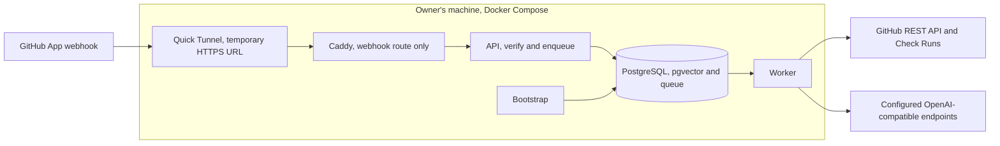

# RepoMonster: audit and roadmap

As of 2026-11-05. Audited commit: `8e55dd8` on `main`.

Working plan for the next stage of work: [`docs/plan.md`](plan.md).

## Summary

RepoMonster's core is sound, but one bug blocks most newly opened PRs, and its own supply chain is looser than the product it is meant to become. The audit covered all 17 modules (about 4,000 lines), the CI workflow, Dockerfile, Compose file and the four declared dependencies.

What passed: 43 unit tests and 1 integration test, mypy on all 17 files, Bandit, and pip-audit (no known vulnerabilities). What needs work: a CI-timing bug, repeated plumbing (three HTTP clients, four database connectors, two copies of service wiring), unpinned tooling and images, and an unauthenticated GitLab route.

Order of work, each phase shipping on its own:

1. **Phase 0, streamline:** fix the bug and remove the duplication before demonstrating the complete workflow.
2. **Phase 1, no-cost local demo:** Docker Compose and a free Cloudflare Quick Tunnel on the owner's machine. AWS is deferred until there is a reason to host the service.
3. **Phase 2, model providers:** native Anthropic (Claude) and OpenAI adapters, replacing the Tailscale-reached local model.
4. **Phase 3, security gate:** deterministic dependency and image checks on every PR, prioritised by Cloudflare's Zero Wire briefings, plus Cloudflare's security-audit-skill for deeper audits.
5. **Phase 4, verification sandbox and attack-pattern library:** reproduce a finding on the base commit, confirm the fix on the head commit, and record recurring patterns.

## Decisions

| Decision | Choice | Status |
| --- | --- | --- |
| Infrastructure | Docker Compose for the local demo; Terraform deferred with AWS hosting | Decided |
| Model access | Claude through the Anthropic API with an API key (local operator configuration; Secrets Manager if later hosted on AWS) | Decided |
| Embeddings | Voyage AI `voyage-4` at 1024 dimensions (Anthropic has no embedding model) | Decided |
| Hosting model | No-cost local demo through a Cloudflare Quick Tunnel; AWS deferred until hosting is needed | Decided |
| Code delivery | Branches and PRs on `leotemtem/repomonster` | Decided |

## Audit findings

Fix finding 1 before anything else: a PR opened while its required CI is still running is marked Blocked and is never re-reviewed when CI finishes. The rest are streamlining items for the demo and any later hosted deployment.

| # | Severity | Finding | Where | Fix |
| --- | --- | --- | --- | --- |
| 1 | High | Required CI is judged at the moment of the webhook. `queued`, `in_progress` and `pending` count as failures (an error), and only `pull_request` events are queued, so nothing re-runs the review when CI completes. | `rules.py` `_check_required_ci`; `app.py` webhook filter | Treat pending checks as "waiting" (check run stays `in_progress`), subscribe to `check_suite` / `check_run` `completed` and `status` events, re-review on completion. |
| 2 | Medium | Every delivery refetches `.repomonster.yml`, the full recursive default-branch tree and all knowledge blobs, then resyncs. | `github/processor.py` `_prepare_review`, `_load_knowledge_sources` | Cache by default-branch tree SHA; resync on `push` to the default branch instead of per PR. |
| 3 | Medium | Lint tooling is unpinned. The current ruff (0.17.3) reports 31 findings on `main` (24 auto-fixable), so CI can go red without a code change. mypy and Bandit are also unpinned. | `ci.yml`; no `[tool.ruff]` in `pyproject.toml` | Add a `dev` extra with pinned versions, a `[tool.ruff]` rule set, and run `ruff check --fix` once. |
| 4 | Medium | No lockfile or hashes. Docker installs version ranges; `python:3.12-slim` and `pgvector/pgvector:pg16` are tag-pinned, not digest-pinned; Actions are pinned by tag, not SHA. A supply-chain gate should pass its own checks. | `pyproject.toml`, `Dockerfile`, `docker-compose.yml`, `ci.yml` | `uv lock` (or `pip-compile --generate-hashes`), digest pins, SHA-pinned Actions, Renovate or Dependabot. |
| 5 | Medium | `/webhooks/gitlab` is unauthenticated, reads JSON with no size cap, and an unknown event raises an unhandled `ValueError` (500). | `app.py` `gitlab_webhook` | Remove until GitLab support ships, or verify `X-Gitlab-Token` and reuse the GitHub size limit. |
| 6 | Medium | A transient model error (429, timeout) ends as `manual_escalation` with no retry, because `ReviewService` catches it and returns a result instead of raising to the job queue. | `service.py` `review` | Retry transient errors with backoff in the provider client; escalate only after retries. |
| 7 | Low | Three hand-written `urllib` clients (GitHub, embeddings, insight) with no retry on 429/5xx; the embeddings timeout is a hard-coded 30 s. | `github/client.py`, `repository.py`, `insights.py` | One `http.py` client (httpx) with timeouts, retries and `Retry-After`. |
| 8 | Low | Four copies of `_connect`, each opening a new connection per call; `/readyz` reaches into the private `repository._connect`. | `jobs.py`, `repository.py`, `github/processor.py`, `management.py` | One `psycopg_pool` pool, injected. RDS connection limits make this necessary on AWS. |
| 9 | Low | Service wiring is duplicated in the API and the worker. | `app.py` `create_app`, `management.py` `_worker` | One `build_review_service()` factory. |
| 10 | Low | The GitHub adapter combined the API client, job processor and Check Run formatting in one module. | `github/client.py`, `github/processor.py`, `github/publish.py` | Split into `github/client.py`, `github/processor.py`, `github/publish.py`. |
| 11 | Low | Naming drift: package `review_gatekeeper`, project `repomonster`, FastAPI title "Review Gatekeeper", two CLIs, and duplicate `/health` and `/healthz`. | `pyproject.toml`, `app.py` | Rename the package to `repomonster`, keep one CLI and one liveness route. |
| 12 | Low | `requires-python >=3.11`, but CI and Docker only run 3.12. | `pyproject.toml`, `ci.yml` | Raise the floor to 3.12, or add 3.11 to a CI matrix. |
| 13 | Low | Six CI jobs each check out and reinstall; four of them install the same packages. | `ci.yml` | Merge format, ruff and mypy into one job; key the cache on the lockfile. |

deptry also flags `uvicorn` as unused; that is a false positive, since the Docker `CMD` runs it.

## Phase 1: no-cost local demo

Run the existing API, worker, bootstrap and PostgreSQL/pgvector services on the
owner's machine with Docker Compose. A free Cloudflare Quick Tunnel supplies a
temporary HTTPS URL without an account or domain. Caddy forwards only POST on the
exact `/webhooks/github` path to the API, which still verifies the signature.
The overlay publishes no host ports and removes the external `shared` network.
The worker alone mounts the operator's App private key, read-only; cloudflared
receives no application secrets.

The machine must stay on. The URL changes each start, so the GitHub App webhook
URL must be updated. Quick Tunnels have no uptime guarantee, and GitHub does not
automatically retry failed webhook deliveries; redeliver them manually. This is a
demonstration setup, not a production service. See the [demo runbook](operations.md#no-cost-local-demo).

AWS hosting, Terraform, RDS, Secrets Manager, ECR and hosted deployment pipelines
are deferred until there is a reason to host the service. Revisit costs,
observability, database roles and deployment security at that point. The model
provider work below remains a later phase; the demo uses the existing
OpenAI-compatible adapters.

## Phase 2: Claude and OpenAI providers

Add native adapters behind the existing `InsightProvider` and `EmbeddingProvider` protocols, chosen by environment variable. Claude is the default review model, called through the official `anthropic` SDK. Keep the current OpenAI-compatible adapter for local models. Do not route Claude through Anthropic's OpenAI-compatible endpoint: Anthropic describes it as intended for testing and comparison, not production ([docs](https://platform.claude.com/docs/en/cli-sdks-libraries/libraries/openai-sdk)).

| Setting | Values | Notes |
| --- | --- | --- |
| `INSIGHT_PROVIDER` | `anthropic` (default), `openai`, `openai_compatible` | `anthropic` uses the Messages API with `output_config.format` (GA, no beta header). `openai` uses the official SDK with a strict `json_schema`. |
| `ANTHROPIC_API_KEY` | secret | From Secrets Manager on AWS, `.env` locally. |
| `EMBEDDING_PROVIDER` | `voyage` (default), `openai`, `openai_compatible` | Anthropic has no embedding model and recommends Voyage AI ([docs](https://platform.claude.com/docs/en/build-with-claude/embeddings)). Default model `voyage-4`: 32K-token context, up to 1,000 texts per request ([docs](https://docs.voyageai.com/docs/embeddings)). Embed knowledge with `input_type=document` and the review query with `input_type=query`. |
| `VOYAGE_API_KEY` | secret | Voyage pricing is $0.06 per 1M tokens for `voyage-4`, with 200M free tokens ([pricing](https://docs.voyageai.com/docs/pricing)). |
| `INSIGHT_MODEL`, `EMBEDDING_MODEL`, `EMBEDDING_DIMENSIONS` | `EMBEDDING_DIMENSIONS=1024` | `voyage-4` offers 256, 512, 1024 (default) or 2048. Use 1024: pgvector's HNSW index on the `vector` type is limited to 2,000 dimensions, which rules out 2048. A new database takes the value at its first migration; the existing 1536 Compose database needs recreating or a migration plus full reindex. |

Three changes are needed in `insights.py` before the Anthropic adapter will work:

- **Drop `maxItems: 20` from the findings schema.** Claude structured outputs reject `maxItems` with a 400 ([docs](https://platform.claude.com/docs/en/build-with-claude/structured-outputs)). The code already truncates evidence to 20, so nothing is lost.
- **Lower-case the `recommendation` value before parsing.** Anthropic notes enum casing can differ from the schema; severity and impact are already lower-cased, recommendation is not.
- **Handle `stop_reason` `refusal` and `max_tokens`** as retryable or escalating errors instead of a JSON parse failure.

Both official SDKs retry 429 and 5xx responses with backoff, which also closes finding 6 for model calls. The Anthropic SDK supports prompt caching, which suits the fixed system prompt and repeated standards text in each brief. Add recorded-response contract tests for each adapter, plus the fixture-based model comparison outlined in [`harness-capabilities.md`](harness-capabilities.md).

## Phase 3: per-PR security gate

Build the gate in two layers: deterministic dependency and image checks on every PR, and Cloudflare's agentic audit where it pays for itself. Cloudflare's [security-audit-skill](https://github.com/cloudflare/security-audit-skill) (MIT) is designed for an interactive coding agent and does not describe CI or per-PR use, so RepoMonster has to orchestrate it.

### Layer 1: deterministic checks on every PR

These read lockfiles, registry metadata and image layers but never run repository code, which keeps RepoMonster's existing execution boundary intact.

| Check | Input | Source |
| --- | --- | --- |
| Added, removed and changed dependencies | Base vs head lockfiles: `package-lock.json`, `pnpm-lock.yaml`, `yarn.lock`, `uv.lock`, `poetry.lock`, `requirements*.txt`, `go.sum`, `Cargo.lock` | Lockfile diff |
| Known vulnerabilities | Every new or changed package version | [OSV `querybatch`](https://google.github.io/osv.dev/post-v1-querybatch) (free, one request for the whole diff) |
| Package health and history | Versions, licences, transitive graph, OpenSSF Scorecard | [deps.dev API](https://blog.deps.dev/api/) (free, no key) |
| Deprecated or yanked | Package and version status | npm `deprecated` field, PyPI yanked flag |
| Risky release signals | Release age under a cooldown (for example 7 days), maintainer change, new install scripts, name close to a popular package, missing provenance | Registry metadata |
| Container images | Changed `FROM` lines, tag-only pins, `latest` | Resolve the digest, generate an SBOM (Syft), scan it (Grype or Trivy) |

Results become findings in a new `supply_chain` category, so the existing profile and auto-block policy decide the gate. Upload them as SARIF too, which closes the "SARIF upload" gap listed in `harness-capabilities.md`.

### Threat intelligence: Cloudflare Zero Wire

[Zero Wire](https://blog.cloudflare.com/zero-wire) is Cloudflare's public feed of briefings on significant critical CVEs in internet-facing software. It does not scan anything; it says which disclosures matter now and what to do. RepoMonster uses it as a priority signal on top of OSV, not as a replacement, because it deliberately covers only a small set of CVEs.

- **Ingest:** the worker polls the [Zero Wire RSS feed](https://developers.cloudflare.com/changelog/post/2026-11-03-radar-zero-wire/) on a schedule (no API or JSON feed is documented) and stores each briefing: CVE IDs, status ("Needs attention" or "Reference"), last-checked date and link. Also pull CISA's Known Exploited Vulnerabilities catalogue directly, since Zero Wire cites it.
- **Match on PRs:** when OSV reports a vulnerability for a new or changed dependency or image package, join its CVE aliases against stored briefings. A "Needs attention" match raises the finding to an error and adds the briefing link and its recommended action to the Check Run.
- **Match without a PR:** keep the latest dependency and image inventory for each default branch. When a new briefing arrives, check every installed repository and open an alert (an issue or a scheduled Check Run) where an affected version is present, so exposure is found even when nobody opens a PR.
- **Feed Phase 4:** a Zero Wire match moves the CVE to the front of the sandbox verification queue, and the briefing's chronology and "facts versus unknowns" seed the attack-pattern entry.
- **Trust boundary:** briefing text is third-party content. It is shown to the model only as evidence, never as instructions, matching how repository text is already handled in `insights.py`.

### Layer 2: agentic audit with security-audit-skill

The skill runs six phases: reconnaissance, coverage-led hunting, adversarial validation, schema-checked `findings.json`, independent re-verification, and reports. Repeat runs are additive and revalidate changed source.

- **When it runs:** nightly or weekly on the default branch, and on PRs that add dependencies or touch trust boundaries (auth, webhook handling, parsers, Dockerfiles, CI).
- **Where it runs:** inside the Phase 4 sandbox, driven by a headless coding agent. The skill requires an OS-enforced sandbox with no network, a sanitised environment and resource limits; without one it leaves leads as `needs_validation` and does not run target code.
- **How results map:** `confirmed` becomes a RepoMonster finding with the skill's severity and can block under `auto_block: enforce`. `needs_validation` becomes a warning and queues a Phase 4 verification job. `rejected` is stored, not shown.
- **Expectation to set:** Cloudflare reports one run found about half of what repeated runs found in total. Treat a per-PR run as a net, not a guarantee, and cap tokens per run.

## Phase 4: verification sandbox and attack-pattern library

A fix counts as verified only when the same reproduction fails safely on the base commit and passes on the head commit. The agent writes each reproduction as an ordinary test in the repository's own framework, so a verified fix leaves a regression test behind.

| Base commit | Head commit | Verdict | Gate effect |
| --- | --- | --- | --- |
| Reproduces | Does not reproduce | Fixed, verified | Pass; propose the test as a regression test |
| Reproduces | Reproduces | Still vulnerable | Block |
| Does not reproduce | Reproduces | Introduced by this PR | Block |
| Does not reproduce | Does not reproduce | Not reproducible | Stays `needs_validation`; maintainer decides |

### Sandbox isolation on AWS

- **Separate account** under AWS Organizations, so a sandbox escape reaches nothing of value.
- **Two stages.** A build stage fetches dependencies through an allowlisted registry proxy. The run stage has no internet gateway, no NAT and no egress; only an ECR endpoint for pulling the built image.
- **No credentials.** No task IAM role, or one that can only write results to a single S3 prefix. Environment scrubbed of secrets.
- **Limits.** Task CPU and memory caps, a hard timeout enforced with `StopTask`, read-only root filesystem, one writable scratch volume.
- **Stronger isolation if needed:** gVisor, or Firecracker microVMs on EC2 bare-metal hosts.
- **Scope rule:** reproductions target only the code under test inside the sandbox, never an external host. A maintainer reviews any reproduction before it is committed.

### Attack-pattern library

Every verified reproduction is recorded as an occurrence of a named pattern. Patterns come from verified results, not raw scanner output, which is what makes the library worth retrieving from.

| Field | Example |
| --- | --- |
| Pattern | Unsigned webhook body parsed before signature check |
| Taxonomy | CWE and CAPEC IDs; for supply chain, the SLSA threat it maps to |
| Surface | Own code, dependency, container image, or CI |
| Entry point and point of failure | `POST /webhooks/…`, then the JSON parser |
| Preconditions | What an attacker needs (network access, a published package, a fork PR) |
| Reproduction | Link to the test and the base and head verdicts |
| Occurrences | Repositories, PRs, first and last seen |

Store it in two new tables (`attack_patterns`, `pattern_occurrences`) with an embedding column, so the existing pgvector retrieval can put similar past patterns into each review brief. When a pattern recurs past a configurable threshold (for example 3 times), RepoMonster proposes an entry in the repository's `.repomonster/standards/security.md` and, where it can be expressed as a rule, a deterministic check. Recurring themes across all repositories go into a periodic report.

## Sources

- [cloudflare/security-audit-skill](https://github.com/cloudflare/security-audit-skill)
- [Claude structured outputs](https://platform.claude.com/docs/en/build-with-claude/structured-outputs)
- [Claude embeddings](https://platform.claude.com/docs/en/build-with-claude/embeddings)
- [Claude OpenAI SDK compatibility](https://platform.claude.com/docs/en/cli-sdks-libraries/libraries/openai-sdk)
- [RDS PostgreSQL pgvector with HNSW](https://aws.amazon.com/about-aws/whats-new/2023/10/amazon-rds-postgresql-pgvector-hnsw-indexing/)
- [OSV querybatch](https://google.github.io/osv.dev/post-v1-querybatch)
- [deps.dev API](https://blog.deps.dev/api/)
- [Introducing Zero Wire](https://blog.cloudflare.com/zero-wire)
- [Zero Wire changelog and RSS feed](https://developers.cloudflare.com/changelog/post/2026-11-03-radar-zero-wire/)
- [Voyage AI text embeddings](https://docs.voyageai.com/docs/embeddings)
- [Voyage AI pricing](https://docs.voyageai.com/docs/pricing)
